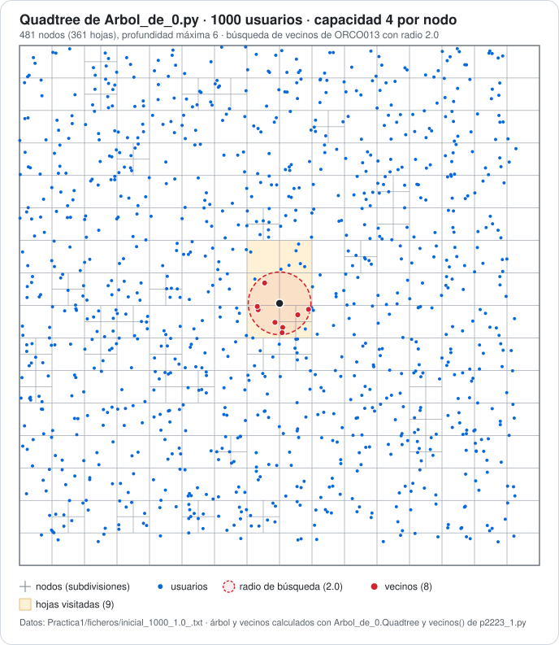
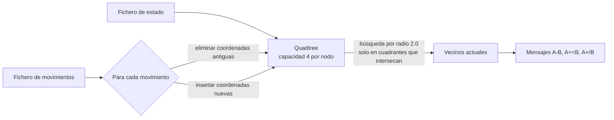

<div align="center">

# Simulador de vecindad con Quadtree

**Simulador en Python que sigue a miles de usuarios por un plano y avisa a sus vecinos cercanos, acelerado con un Quadtree implementado desde cero**


<sub>Estructuras de Datos y Algoritmos · Grado en Ingeniería Informática · Universidad de Valladolid · Curso 2022-2023</sub>

</div>

<p align="center">
  
  <br>
  <sub>Quadtree real construido por el código con 1000 usuarios de <code>Practica1/ficheros/inicial_1000_1.0_.txt</code>.</sub>
</p>

## En pocas palabras

- **Reto:** recalcular, tras cada movimiento, qué usuarios están dentro de la zona de control de otro, con ficheros de 14 000 y 50 000 usuarios.
- **Solución:** una primera versión con búsqueda lineal y una segunda con un Quadtree propio que limita la búsqueda a las regiones del plano que importan.
- **Demuestra:** diseño de estructuras de datos espaciales, análisis de complejidad, medición de rendimiento y comparación con una versión de referencia.

## Lo más destacado

- **Quadtree escrito desde cero** (`Arbol_de_0.py`): clases `Punto`, `Rectangulo` y `Quadtree` con inserción recursiva, subdivisión en cuatro cuadrantes, eliminación y búsqueda por radio.
- **Unos 0,65 s frente a 47 s** con `inicial_14000_1.0_.txt`, comparando la versión con Quadtree y la de búsqueda lineal (`sin_mejorar.py`) en una ejecución local no oficial.
- **Actualización incremental:** cada usuario que se mueve se elimina del árbol con sus coordenadas antiguas y se reinserta con las nuevas, sin reconstruir el árbol.
- **Acceso directo por identificador:** los usuarios se guardan en un diccionario, así que localizar al usuario de cada movimiento no exige recorrer una lista.
- **Dos modos de uso:** depuración (`D`), que procesa los movimientos del fichero y genera los mensajes, y medición (`M`), que genera movimientos aleatorios y mide el tiempo de cada ciclo.
- **Análisis de rendimiento entregados** en [`Practica1/ENTREGA/analisis.pdf`](Practica1/ENTREGA/analisis.pdf) y [`Practica2/ENTREGA/analisis.pdf`](Practica2/ENTREGA/analisis.pdf).

## Competencias

| Área | Qué se aplicó |
|------|---------------|
| Estructuras de datos | Quadtree, diccionarios indexados por identificador |
| Algoritmia | Paso de búsqueda O(n) por usuario a búsqueda espacial por regiones |
| Rendimiento | Modo de medición por ciclos y comparación con una versión de referencia |
| Python | Solo biblioteca estándar (`math`, `random`, `time`) |

## Qué hace

- Lee un fichero de estado inicial con cada usuario: identificador, coordenadas `x y`, grupo y lista de vecinos.
- Aplica un fichero de movimientos y recalcula qué usuarios quedan dentro de la zona de control (radio 2.0).
- Genera los mensajes de entrada y salida de vecinos: `A-B` cuando B sale de la zona, `A+=B` cuando entra uno del mismo grupo y `A+/B` cuando entra uno de otro grupo.

## Arquitectura



- **Práctica 1:** cada `Usuario` busca sus vecinos recorriendo a todos los demás y calculando la distancia euclídea, es decir, una búsqueda O(n) por usuario.
- **Práctica 2:** `Arbol_de_0.py` implementa el Quadtree con capacidad 4 por nodo. La búsqueda por radio solo baja a las regiones que intersecan con la zona de control. Los límites del árbol se calculan a partir del máximo de `x` e `y` entre el estado inicial y los movimientos.
- `sin_mejorar.py` conserva la versión de referencia con búsqueda lineal para comparar.

## Estructura del repositorio

```
EDA/
├── docs/screenshots/     # visualización del Quadtree (quadtree.svg)
├── Practica1/
│   ├── practica.py        # programa principal (modos D y M)
│   ├── usuarios.py        # clase Usuario y búsqueda de vecinos
│   ├── ficheros/          # ficheros de estado, movimientos y mensajes de prueba
│   ├── ENTREGA/           # análisis y código entregado
│   └── DEFENSA/           # versión y ficheros usados en la defensa
└── Practica2/
    ├── p2223_1.py         # programa principal con Quadtree
    ├── Arbol_de_0.py      # implementación del Quadtree
    ├── sin_mejorar.py     # versión de referencia sin Quadtree
    ├── comprobacion.py    # script auxiliar que compara ficheros de mensajes
    ├── *_14000_*.txt, *_50000_*.txt   # ficheros de prueba
    ├── ENTREGA/
    └── DEFENSA/
```

## Requisitos

- Python 3.6 o superior (la práctica 2 usa f-strings)

## Cómo ejecutarlo

Los programas son interactivos: piden el nombre del fichero de estado, el modo y, en modo depuración, el fichero de movimientos. Los parámetros `n` y `d` se extraen del nombre del fichero (`inicial_<n>_<d>_.txt`), así que hay que conservar ese formato.

<details>
<summary>Práctica 1 (búsqueda lineal)</summary>

Se ejecuta desde su carpeta, porque importa `usuarios.py`:

```bash
cd Practica1
python3 practica.py
# Fichero de estado: ficheros/inicial_10_1.0_.txt
# Modo [D]epuracion o [M]edicion? D
# Fichero de movimientos: ficheros/movs_10_0.4_.txt
```

</details>

<details>
<summary>Práctica 2 (Quadtree)</summary>

```bash
cd Practica2
python3 p2223_1.py
# Fichero de estado: inicial_14000_1.0_.txt
# Modo [D]epuración o [M]edición? D
# Fichero de movimientos:        (en blanco se usa movs_14000_1.0_.txt)
```

En modo depuración escribe los mensajes en `msgs_<n>_<d>_.txt`, en el directorio actual, y sobrescribe el que haya.

</details>

Ambas ejecuciones se han probado con Python 3 sobre una copia del repositorio.

## Estado y limitaciones

- La comparación de 0,65 s frente a 47 s procede de una única ejecución local; no es una medición oficial.
- Los programas son interactivos y no aceptan argumentos por línea de comandos.

## Autoría

Trabajo en pareja (subgrupo de laboratorio K2). Según la cabecera del código, sus autores son Javier García González y Azael Bastardo Rodríguez.

---

<div align="center"><sub>Parte de <a href="https://github.com/JavivuG/UVa-Projects">UVa-Projects</a> · Javier García González</sub></div>
